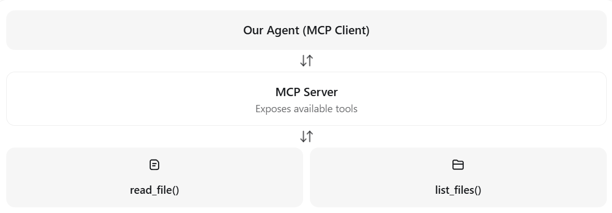

# agent-platform-lab
A small platform for running, observing, and evaluating AI coding agents through MCP tools.

The project will progressively add:

- an agent execution loop;
- repository tools exposed through MCP;
- evaluation and tracing;
- Docker packaging;
- Kubernetes deployment;
- human approval and security controls.

## Learning notes

### Unit 1: Basics

We hear a lot these buzz words nowadays, "agents," "LLMs," ...

So, **What is an agent?** This is the first question that I ask for entering this new realm! The easiest-to-understand description that I have found so far is:


>An agent is an LLM that can decide to use tools while working toward a task


And an *AI* agent combines:

>1. An **LLM** model that `selects` **actions**;
>2. **Instructions** defining its objective and constraints;
>3. **Tools** for interacting with external systems;
>4. An **execution loop** that `observes` *results* and chooses the next action.


Here, there is a delicate distinction between **instructions** and **prompts**. We have heard prompt, promptong, prompt engineering, which is delicately different than instructions. 

A **prompt** is the input text or messages provided to an LLM, which is given by the user. However, instructions are the part that tells the LLM how to behave, what its role is, and what contraints to follow, which are usually defined by the developer. For example the following one shows instructions for the agent:

>instructions = """
>You are a repository assistant.
>Help users understand their code.
>Use available tools to inspect files.
>Never modify files without approval.
>"""

And this one is an user prompt:

>user_prompt = "Find all TODOs in this repository."


The LLM receives both and uses them to decide what to do.

One important distinction: instructions influence the LLM's behavior, but **security restrictions** must still be enforced in **Python**, as we will see later.


I personally prefer seeing good practical examples to build intuitions about concepts. To follow that tradition, Let's consider a practical and detailed example for understanding an agent's distinctino from a bare LLM.

Consider the case, we have an LLM and the following question is prompted to it:


>User: What files exist in my Documents folder?
>LLM: I do not know!


This is because, the LLM generates text based on what you gave it.

An agent adds the ability for the LLM to take actions using tools and get more data into its response generation. So, if we have an agent, the following process will continue, so we will get the response we want.


>User: asks the same question
> ↓
>LLM
> ↓
>`decides`: "I need to inspect that folder"
> ↓
>calls **a tool**, for example: list_files(), a python module
> ↓
>gets the result from that tool
> ↓
>LLM: generates repsonse based on the query and the results from that tool
> ↓
>**Answer**

So, now it is clear for us why:

>Agent is an LLM that can decide to use tools while working toward a task.


In the next step, the question that comes up is: what is actually a **tool**?

>A tool is a function that an agent can call to interact with something outside the LLM. 

For example for our need for the earlier example:

```python
# Source - https://stackoverflow.com/a/3207973
# Posted by pycruft, modified by community. See post 'Timeline' for change history
# Retrieved 2026-10-19, License - CC BY-SA 4.0

from os import listdir
from os.path import isfile, join


def list_files(mypath):
    onlyfiles = [f for f in listdir(mypath) if isfile(join(mypath, f))]
    return onlyfiles
```

So, to wrapup what we learned so far:


>- LLM: Decides which tool to use.
>- Tool: Performs the actual operation.
>- Agent: Coordinates the process.


In the next step, we reach to the **agent loop**! This loop lets an LLM to make multiple decisions in an interactive way with tools and their results until it completes a task. For example, the user asks: "find TODOs in my README file in the files I shared with you," then:


>1. LLM decides → read_file("README.md")
>2. Tool executes → returns file contents
>3. LLM examines contents
>4. LLM decides → return final answer
>5. Agent stops


Because after each tool execution, the LLM gets another opportunity to decide what to do next, which is called an action. For example an LLM can have tool action or final action.


>An Action describes a decision. It does not execute anything itself.


So, the agent loop takes care of that action and consumes it. The loop checks the action's type, and calls the appropriate tool.

So, now the next concept in this constellation is **tool executor**.

A tool executor is the part of the agent loop that runs the tool requested by the LLM. For example"

```python
if action.kind == "tool":
    result = execute_tool(
        action.name,
        action.arguments
    )
```

Then, the result of the tool is passed to the LLM via the agent loop.


>The executor should only allow approved tools (via **tool registery**), not arbitrary functions (like Python functions generated by LLM. We mudt never give permission for executing those generated functions! Letting LLM execute its generated scripts does not sound secure at all!).


The LLM might request a dangerous operation, such as deleting files. The tool executor acts as a controlled boundary, allowing only permitted operations.

A tool registry is a collection of tools that our agent is allowed to use. A registry is one layer of protection; registered tools still need appropriate permissions and input validation.


For remaining on the secure and safe side of the story, besides tool registry, defining a workspace boundary is a necessity.


>The restriction must be enforced by the tool's code, not merely described in the LLM's instructions. Stronger isolation may also require operating-system permissions or sandboxing.


And security should never ever be handled via prompting:


>Security must be enforced by code, not just by prompts.

Here is where MCP comes into the game.

#### Model Concept Protocol (MCP)

MCP is a standard protocol that lets AI applications connect to external tools and data sources.

Without MCP, we might integrate each tool directly into our agent. With MCP, tools can be provided by a separate MCP server.




Why use MCP? We can connect different agents to the same tools through a standardized interface rather than building a custom integration for each one.

>MCP doesn't automatically make tools safe; **workspace restrictions and permissions** still matter.

There are two important components:

>MCP Server: Exposes tools
>MCP Client: Connects to the server, discovers **available tools**, and *requests* their execution


### Unit 2: Installable package and CLI

**pyproject.toml** defines project metadata, dependencies, build configuration, and executable commands. The src/ layout prevents accidental imports from the repository root.

```
The [project.scripts] entry creates the agent-platform terminal command.
```

The project uses the `src/` layout so application imports come from the installed
package rather than accidentally resolving against files in the repository root.

`pyproject.toml` provides one place for package metadata, dependencies, build
configuration, test configuration, and CLI entry points.


```powershell
python -m venv .venv
.\.venv\Scripts\Activate.ps1
python -m pip install -e ".[dev]"
python -m pytest
agent-platform "inspect the repository"
```

In Linux/ Mac, it is different:

```
python -m venv .venv
source .venv/bin/activate
python -m pip install -e ".[dev]"
python -m pytest
```

Question:

```
Why use an installable package instead of running loose Python scripts?
```

Answer:

```
It provides reproducible dependencies, stable imports, testable modules, and a defined command-line interface suitable for deployment.
```

### Unit 3: Build a bounded agent loop

An agent repeatedly asks a model for the next action until it produces a final answer. A turn limit prevents infinite or excessively expensive execution.

